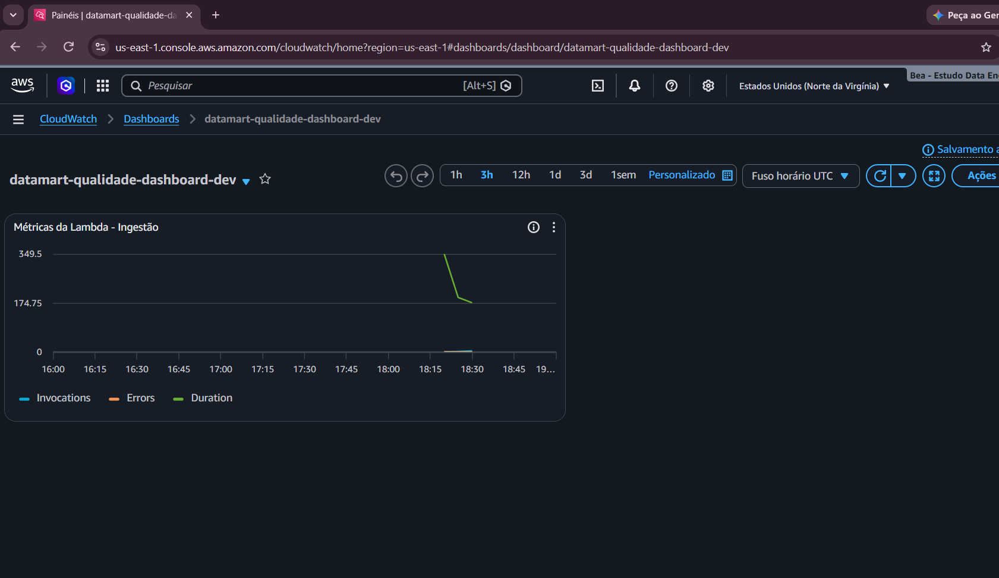

# 🟣 DataMart Analytics - Projeto 4: Observabilidade e FinOps

Este projeto evolui a arquitetura do Projeto 3 adicionando duas camadas essenciais para qualquer pipeline que roda em produção: **Observabilidade** (saber quando algo quebrou antes do cliente reclamar) e **FinOps** (ter controle e previsibilidade dos custos de nuvem).


## 🎯 O Problema de Negócio

O pipeline da DataMart está processando dados com qualidade, mas a equipe de engenharia estava "cega". Se a Lambda falhasse, ninguém saberia. Além disso, não havia alertas caso os custos da AWS subissem por causa de um loop infinito ou processamento indevido.

**A Solução:**
1. **Observabilidade:** Alarmes do CloudWatch monitoram erros e lentidão na Lambda. Se algo falhar, um alerta é enviado por e-mail via SNS.
2. **Dashboards Visuais:** Painel de controle para acompanhar as métricas do pipeline em tempo real.
3. **FinOps:** Configuração de AWS Budgets para alertar se o custo mensal ultrapassar $1.00.

## 🏗️ Arquitetura

```text
[Gerador] → [S3 raw/] → [Lambda] → (DynamoDB: Idempotência)
                            ↓
                (CloudWatch: Métricas e Logs)
                            ↓
             (CloudWatch Alarmes) → (SNS Topic) → 📧 E-mail
                            ↓
                 (CloudWatch Dashboard)

[Amazon Budgets] → Monitora Custos → 📧 E-mail

🛠️ Tecnologias Utilizadas
Amazon CloudWatch — Métricas, Logs, Alarmes e Dashboards.

Amazon SNS — Notificações por e-mail (Simple Notification Service).

AWS Budgets — Controle de custos e alertas financeiros (FinOps).

AWS Lambda + S3 + DynamoDB — Base do pipeline de processamento.

Terraform — Provisionamento 100% Infrastructure as Code (IaC).

## 📊 Monitoramento em Tempo Real (CloudWatch Dashboard)

Abaixo está a prova visual do dashboard configurado via Terraform monitorando as métricas de execução da Lambda:

