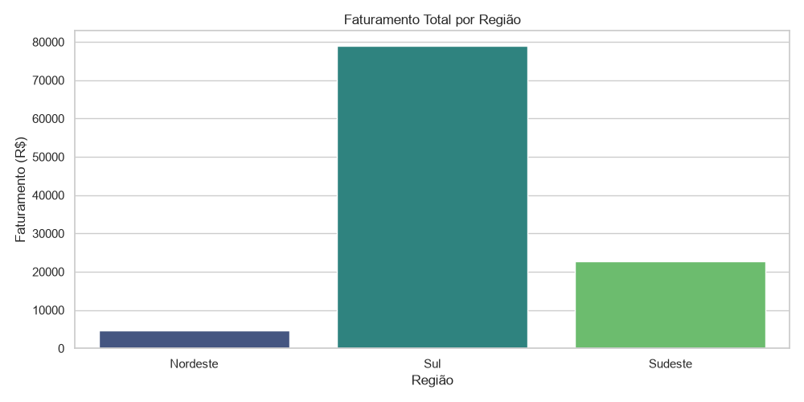
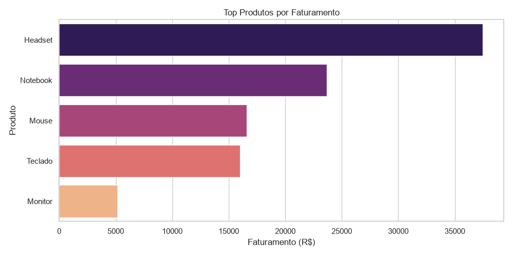
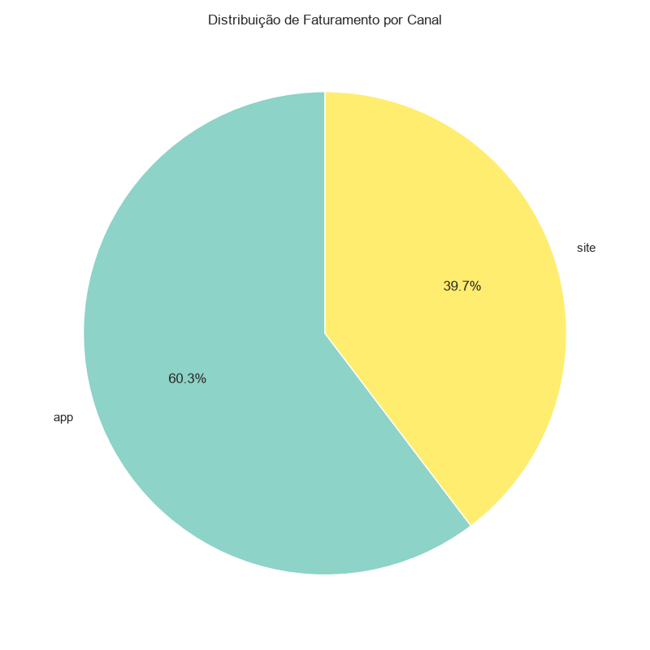

# 🔴 DataMart Analytics - Projeto 5: Analytics, IA e Visualização de Dados

O projeto final da jornada. Evoluímos o pipeline para entregar **valor de negócio real** através de um Dashboard Executivo, unindo Engenharia de Dados, Inteligência Artificial e Visualização de Dados com Python.


---

## 🎯 O Problema de Negócio

A equipe de engenharia entregou um pipeline perfeito, mas a diretoria da DataMart não sabe ler JSON ou SQL. Eles precisam de visões gráficas para responder perguntas como: *"Qual região vende mais?"* ou *"Qual é o nosso ticket médio?"*. Além disso, a empresa quer começar a usar Inteligência Artificial para acelerar a análise de dados.

### 💡 A Solução
1. **Consultas Analíticas (Athena):** Criação de tabelas externas apontando para os dados em Parquet (camada `refined/`) no S3.
2. **IA como Copiloto (Amazon Q):** Uso da Inteligência Artificial da AWS para gerar queries SQL analíticas avançadas (Window Functions, agregações).
3. **Visualização de Dados (Python):** Devido a restrições de segurança da AWS (conta nova) no Amazon QuickSight, a solução de contorno (workaround) foi criar um Dashboard Executivo usando **Python (Pandas + Matplotlib/Seaborn)**.

---

## 🏗️ Arquitetura

```text
[Gerador] → [S3 raw/] → [Lambda] → (DynamoDB: Idempotência)
                            ↓
                  [S3 trusted/] (dados bons)
                            ↓
                  [ETL Local Python] → [S3 refined/] (Parquet)
                            ↓
                  [Amazon Athena] (Queries SQL + Amazon Q)
                            ↓
                  [Python Matplotlib] (Dashboards Visuais)
```

---

## 🛠️ Tecnologias Utilizadas

- **Amazon Athena** — Consultas SQL direto no S3 (Serverless).
- **Amazon Q** — Inteligência Artificial para geração de queries.
- **Python + Pandas** — Leitura dos dados em Parquet.
- **Matplotlib + Seaborn** — Criação dos gráficos executivos.
- **Terraform** — Provisionamento 100% Infrastructure as Code (IaC).

---

## 📊 Monitoramento e Dashboards (Gerados via Python)

Abaixo, a prova visual dos gráficos gerados pelo script `graficos.py` para a diretoria:

### Faturamento por Região


### Top Produtos


### Distribuição por Canal


---

## 🚀 Como Reproduzir

### Pré-requisitos
- Terraform >= 1.5.0
- AWS CLI configurado
- Python 3.10+ com as dependências: `py -m pip install -r requirements.txt`

### 1. Provisionar a Infraestrutura
```bash
cd terraform
terraform init
terraform apply -auto-approve
cd ..
```

### 2. Processar os Dados
```bash
# Gera os dados e envia para o S3
py scripts/gerador.py

# Move os dados e roda o ETL (Gera o Parquet)
py scripts/etl_local.py
```

### 3. Criar a Tabela no Athena
Acesse o Console AWS -> Athena e execute a query contida em `sql/queries.sql` para criar a tabela externa `vendas_refined`.

### 4. Gerar os Gráficos (Visualização)
```bash
py scripts/graficos.py
```
Os gráficos serão salvos automaticamente na pasta `docs/`.

### 5. Destruir tudo (FinOps)
Para garantir que nenhum recurso fique rodando e gerando custos:
```bash
cd terraform
terraform destroy -auto-approve
```

---

## 📚 Aprendizados

- Criação de tabelas externas e consultas no **Amazon Athena**.
- Uso do **Amazon Q** (IA Generativa) como copiloto para escrever SQL.
- Manipulação de dados com **Pandas** e criação de visualizações executivas com **Matplotlib e Seaborn**.
- Adaptabilidade: contornar bloqueios de conta na AWS com soluções em Python (Engenharia de Dados na prática).
- Fechamento do ciclo de FinOps: criação e destruição 100% automatizada via IaC.

---

## 👩‍💻 Autora

**Beatriz Lima** — Estudante de Engenharia de Dados
[LinkedIn](https://www.linkedin.com/in/bealimav/) | [GitHub](https://github.com/bealimav)
